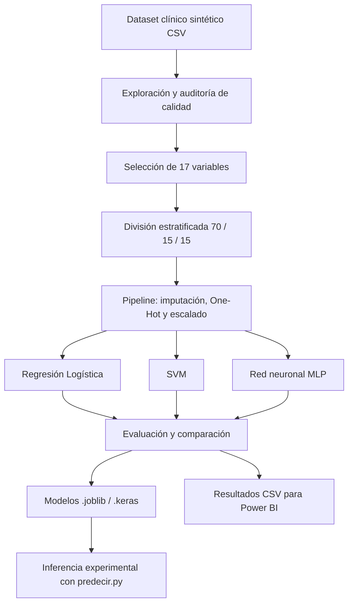

# Sistema de Alerta Temprana de Riesgo Materno-Perinatal en Zonas Dispersas y Comunidades Indígenas


## 1. Descripción del proyecto

Este repositorio contiene el desarrollo experimental de la **Fase 2** de un sistema de alerta temprana para estudiar factores asociados al **riesgo materno-perinatal** en zonas rurales dispersas y comunidades indígenas de **Cesar y La Guajira (Colombia)**.

En la propuesta inicial se planteó una solución que, en etapas posteriores, podría apoyar a promotores de salud mediante clasificación predictiva, reglas clínicas y funcionamiento móvil sin conexión permanente. **El alcance realmente desarrollado aquí es el modelado y la evaluación académica de algoritmos supervisados**, junto con scripts de inferencia y resultados para visualización en Power BI. No se ha demostrado validación clínica ni se debe interpretar que una aplicación móvil, un motor de reglas clínicas o el modo offline estén implementados.

### Objetivos técnicos de esta fase

- Analizar la calidad de un dataset sintético de controles prenatales e implementar el preprocesamiento reproducible.
- Construir una referencia de comparación (*baseline*) y entrenar **Regresión Logística, SVM y redes neuronales MLP**.
- Comparar la clasificación de **nivel de riesgo (Bajo, Medio, Alto)** y la predicción **binaria exploratoria** de un desenlace adverso.
- Medir las diferencias entre modelos con métricas apropiadas para clases desbalanceadas, estudiar umbrales y realizar auditorías exploratorias por grupos poblacionales y territoriales.
- Exportar los modelos para ejecutar inferencias desde Python y visualizar resultados en Power BI.

## 2. Equipo y contexto académico

| Campo | Información |
|---|---|
| Institución | Universidad Popular del Cesar (UPC) |
| Programa | Ingeniería de Sistemas |
| Asignatura | Inteligencia Artificial |
| Docente | Tonny Jiménez Márquez |
| Grupo | 02 |
| Integrantes | Dharla Jose Duran Riobo; Cesar Andrés Amaya Díaz; Oscar Andrés Hundelshaussen Barreto |
| Etapa | Fase 2 — Desarrollo y Modelado |


## 3. Tecnologías y herramientas

| Tecnología | Uso |
|---|---|
| Python | Preparación de datos, entrenamiento, evaluación e inferencia |
| Google Colab / Jupyter | Cuaderno experimental y ejecución de los entrenamientos |
| Pandas y NumPy | Manipulación y procesamiento tabular |
| Scikit-learn | Pipelines, imputación, codificación, escalado, Regresión Logística, SVM y métricas |
| TensorFlow / Keras | Construcción, entrenamiento y carga de redes neuronales MLP |
| Matplotlib | Curvas, matrices de confusión y gráficos comparativos |
| Joblib | Serialización de pipelines de Scikit-learn y preprocesadores |
| Power BI | Dashboard de exploración inicial, métricas y auditorías de subgrupos |
| Git / GitHub y VS Code | Control de versiones, organización y ejecución local |

## 4. Datos utilizados

El experimento predictivo trabaja con **1.508 registros sintéticos y 21 columnas**, con fechas comprendidas entre el **01/01/2023 y el 31/12/2025**. La propuesta inicial también menciona las Estadísticas Vitales del DANE como contexto epidemiológico.

### Variables originales

| Tipo | Columnas |
|---|---|
| Identificación / fecha | `id_paciente`, `fecha_control` |
| Geografía / población | `municipio`, `departamento`, `etnia`, `zona`, `afiliacion_sgsss` |
| Control prenatal y acceso | `edad_materna`, `semanas_gestacion_control`, `numero_controles_prenatales`, `distancia_centro_salud_km`, `tiempo_traslado_horas` |
| Clínicas | `hemoglobina_g_dl`, `presion_sistolica`, `presion_diastolica`, `imc` |
| Antecedentes | `antecedente_preeclampsia`, `antecedente_diabetes_gestacional`, `parto_institucional_previo` |
| Etiquetas | `nivel_riesgo`, `resultado_gestacion` |

Para ambos experimentos se emplearon **17 variables predictoras**. Se excluyeron `id_paciente`, `fecha_control` y **las dos columnas de etiquetas** de las entradas del modelo, para evitar utilizar como predictor un resultado que podría no conocerse al momento de la evaluación.

### Distribución de clases

**Nivel de riesgo**

| Categoría | Registros | Proporción |
|---|---:|---:|
| Bajo | 1.023 | 67,84 % |
| Medio | 334 | 22,15 % |
| Alto | 151 | 10,01 % |

**Resultado de gestación original**

| Categoría | Registros | Proporción |
|---|---:|---:|
| Normal | 1.421 | 94,23 % |
| Complicación obstétrica | 69 | 4,58 % |
| Mortalidad materna | 18 | 1,19 % |

Para el segundo experimento, y **debido al número reducido de registros de mortalidad**, se agruparon `Complicación obstétrica` y `Mortalidad materna` en la etiqueta binaria **desenlace adverso (1)**, frente a **Normal (0)**: **87 casos positivos (5,77 %)**. Esta simplificación **no cumple por sí sola la clasificación original de tres desenlaces** y se documenta como una decisión metodológica de alcance exploratorio.

### Calidad de datos identificada

| Columna | Nulos |
|---|---:|
| `numero_controles_prenatales` | 79 |
| `distancia_centro_salud_km` | 70 |
| `hemoglobina_g_dl` | 178 |
| `presion_sistolica` | 127 |
| `presion_diastolica` | 139 |
| `imc` | 201 |

No se detectaron registros completos duplicados inicialmente. Una auditoría posterior encontró **16 registros con características predictoras idénticas**, sin grupos de etiquetas contradictorias; hubo **1 coincidencia prueba–entrenamiento** en la tarea de riesgo y **2** en la de desenlace. Se documentó un análisis de sensibilidad al excluir esas coincidencias. El procedimiento de generación de las etiquetas sintéticas **no ha sido verificado en este repositorio** y representa una limitación relevante.

## 5. Metodología y flujo de trabajo



### 5.1. Particiones

Para cada tarea se dividieron los registros de forma **estratificada**, con semilla `random_state=42`:

| Conjunto | Registros | Porcentaje aproximado |
|---|---:|---:|
| Entrenamiento | 1.055 | 70 % |
| Validación | 226 | 15 % |
| Prueba | 227 | 15 % |

El preprocesamiento se **ajustó exclusivamente con entrenamiento** y se aplicó después a validación y prueba. El conjunto de prueba quedó reservado para la evaluación final de los candidatos previamente definidos.

### 5.2. Preprocesamiento

- **Numéricos:** imputación con **mediana** y estandarización (`StandardScaler`).
- **Categóricos:** imputación por **moda** y codificación `OneHotEncoder(handle_unknown="ignore")`.
- **Modelos tradicionales:** pipelines de Scikit-learn para aplicar las transformaciones de la misma forma en entrenamiento e inferencia.
- **Redes neuronales:** transformación de las entradas a matrices `float32`; codificación de la etiqueta multiclase con `LabelEncoder`.
- **Desbalance:** ponderación de clases (`class_weight="balanced"` o pesos calculados). **SMOTE se mencionó en la propuesta, pero no se reporta como aplicado en estos experimentos.**

### 5.3. Modelos

| Modelo | Función / configuración utilizada |
|---|---|
| Dummy | Referencia que predice siempre la clase mayoritaria |
| Regresión Logística | Clasificación supervisada con ponderación de clases y `max_iter` ampliado |
| SVM | Kernel RBF y ponderación de clases; búsqueda de `C` y `gamma` |
| MLP para riesgo | Capas densas de **64 y 32 neuronas**, ReLU, `Dropout(0.20)`, salida **Softmax** de tres clases |
| MLP para desenlace | Capas densas de **32 y 16 neuronas**, ReLU, regularización L2, `Dropout(0.25)`, salida **Sigmoid** binaria |

Se utilizó `EarlyStopping` para detener el entrenamiento de las redes ante el estancamiento de la pérdida de validación y restaurar los mejores pesos observados. En SVM se realizó una búsqueda con `GridSearchCV` y validación cruzada estratificada de cinco particiones; para el experimento de riesgo se seleccionó **`C=1`, `gamma=0.1`** en el espacio explorado.

## 6. Resultados experimentales

**Todas las tablas siguientes corresponden a datos sintéticos, no a una validación clínica.** En particular, el número de clases minoritarias es reducido y las cifras pueden variar entre particiones.

### 6.1. Clasificación del nivel de riesgo — prueba final

**Conjunto de prueba:** 227 registros, de los cuales **23** son de riesgo Alto.

| Modelo | Accuracy | F1-macro | Recall Alto | Precisión Alto | Altos detectados / 23 |
|---|---:|---:|---:|---:|---:|
| Dummy | 67,84 % | 0,2695 | 0,00 % | 0,00 % | 0 |
| Regresión Logística | 60,35 % | 0,4760 | 56,52 % | 27,66 % | 13 |
| SVM optimizado | 60,35 % | 0,4600 | 30,43 % | 33,33 % | 7 |
| **MLP original** | **64,76 %** | **0,5230** | 52,17 % | **41,38 %** | 12 |
| MLP con umbral Alto 0,25 | 60,79 % | 0,4678 | **60,87 %** | 27,45 % | **14** |

**Interpretación:** la MLP original obtuvo el **mayor F1-macro** de los modelos entrenados en prueba. Cambiar el umbral de Alto a **0,25** elevó el recall de esa clase, pero redujo su precisión. En validación, el mismo umbral había alcanzado **82,61 %** de recall Alto; en prueba bajó a **60,87 %**, lo que muestra variabilidad entre particiones. El Dummy logró mayor accuracy que los modelos entrenados porque la clase Bajo es mayoritaria, pero no detectó ningún Alto.

### 6.2. Predicción binaria de desenlace adverso — prueba final

**Conjunto de prueba:** 227 registros; **214 normales y 13 adversos**.

| Modelo / umbral | Accuracy | F1 adverso | Recall adverso | Precisión adverso | AP | TP / FN / FP |
|---|---:|---:|---:|---:|---:|---|
| Regresión Logística / 0,30 | 69,60 % | 0,2737 | **100,00 %** | 15,85 % | **0,3482** | 13 / 0 / 69 |
| **MLP / 0,50** | 89,87 % | **0,3784** | 53,85 % | **29,17 %** | 0,2765 | 7 / 6 / 17 |
| SVM / predicción estándar | **90,75 %** | 0,2759 | 30,77 % | 25,00 % | 0,2489 | 4 / 9 / 12 |

`TP`: verdaderos positivos; `FN`: falsos negativos; `FP`: falsos positivos; `AP`: *Average Precision* de la curva Precision–Recall.

**Interpretación:** la Regresión Logística con umbral **0,30**, seleccionado provisionalmente mediante validación cruzada sobre entrenamiento, detectó **13 de 13** casos adversos en prueba, pero generó **69 falsas alertas**. La MLP produjo menos falsas alertas (**17**) y obtuvo el **mayor F1 de la clase adversa**, aunque no detectó **6** positivos. El SVM alcanzó mayor accuracy, pero dejó sin detectar **9** casos adversos. Un Dummy que predijera siempre Normal alcanzaría aproximadamente **94,27 % de accuracy** en esta prueba, sin detectar ningún positivo; por eso no se utiliza la exactitud aislada como criterio de selección.

> [!NOTE]
> El **100 % de recall** observado para la Regresión Logística se obtuvo sobre **solo 13 casos sintéticos de prueba** y **no implica** sensibilidad perfecta en poblaciones nuevas. Los valores Softmax y Sigmoid tampoco deben tratarse como probabilidades clínicas calibradas.

### 6.3. Decisiones sobre umbrales

- **Riesgo Alto (MLP):** se exploraron umbrales desde 0,20 a 0,60. El umbral **0,25** se conservó como alternativa experimental orientada a mejorar la sensibilidad.
- **Desenlace adverso (Regresión Logística):** se exploraron umbrales en validación y posteriormente se seleccionó **0,30** con predicciones *out-of-fold* sobre entrenamiento, priorizando una meta **académica** de al menos 75 % de recall.
- **Desenlace adverso (MLP):** se mantuvo **0,50** para la evaluación de prueba reportada.

Estas reglas de decisión no derivan de protocolos médicos y no deben utilizarse para decisiones asistenciales.

### 6.4. Auditoría exploratoria por etnia y territorio

Se examinaron las predicciones finales de prueba por etnia, zona y departamento. Entre los resultados descriptivos:

| Experimento / modelo | Subgrupo | Positivos detectados | Recall observado |
|---|---|---:|---:|
| Riesgo Alto — MLP | No indígena | 8 de 13 | 61,54 % |
| Riesgo Alto — MLP | Wayuu | 3 de 8 | 37,50 % |
| Riesgo Alto — MLP | Rural dispersa | 6 de 12 | 50,00 % |
| Desenlace adverso — MLP | No indígena | 4 de 7 | 57,14 % |
| Desenlace adverso — MLP | Wayuu | 2 de 5 | 40,00 % |
| Desenlace adverso — MLP | Rural dispersa | 3 de 8 | 37,50 % |

**Precaución:** los tamaños muestrales son muy pequeños. Estas diferencias **no prueban sesgos sistemáticos** ni justifican conclusiones sobre grupos étnicos. En la exportación `auditoria_subgrupos_fase2.csv` se incluye la columna `Muestra limitada` y se omiten métricas en subgrupos particularmente pequeños.

### 6.5. Principales limitaciones

1. **Datos y etiquetas sintéticas:** la procedencia exacta de las reglas con las que se generaron `nivel_riesgo` y `resultado_gestacion` no ha sido auditada. En el dataset, **todos los desenlaces adversos están etiquetados como riesgo Alto**; esa dependencia podría reflejar reglas artificiales de generación.
2. **Clases desbalanceadas:** solo había **18 registros de mortalidad** en el dataset completo y **13 desenlaces adversos** en el conjunto de prueba binaria.
3. **Posibles duplicaciones entre particiones:** se hallaron 1 y 2 coincidencias de características entre entrenamiento y prueba según la tarea. Excluirlas en un análisis de sensibilidad alteró poco las métricas, pero no elimina otras posibles fugas.
4. **Sobreajuste y estabilidad:** las curvas de aprendizaje de las MLP mostraron señales de sobreajuste; se utilizó `EarlyStopping`. Las métricas cambiaron entre validación y prueba.
5. **Alcance:** no se implementó ni validó un sistema clínico, una interfaz móvil offline ni el motor definitivo de reglas obstétricas. Tampoco se validó el desempeño sobre datos reales, hospitales o comunidades.

## 7. Organización del repositorio

Estructura recomendada, respetando los nombres de carpetas que se han venido usando en VS Code:

```text
RIESGO-MATERNO-PERINATAL-EN-ZONAS-INDIGENAS---IA-FASE2/
├── Documentacion/
│   └── PROYECTO DE INTELIGENCIA ARTIFICIAL.pdf
├── Modelos/
│   ├── riesgo_mlp.keras
│   ├── riesgo_componentes.joblib
│   ├── riesgo_logistica.joblib
│   ├── riesgo_svm.joblib
│   ├── desenlace_mlp.keras
│   ├── desenlace_componentes.joblib
│   ├── desenlace_logistica.joblib
│   └── desenlace_svm.joblib
├── Notebooks/
│   └── Fase2_Entrenamiento_IA.ipynb
├── Resultados/
│   ├── evaluacion_final_nivel_riesgo.csv
│   ├── evaluacion_final_desenlace.csv
│   ├── resultados_fase2_powerbi.csv
│   ├── auditoria_subgrupos_fase2.csv
│   └── predicciones_demo.csv             
├── Datos/                            
│   └── dataset_riesgo_materno_perinatal.csv
├── predecir.py
├── configuracion.json
├── requirements.txt
├── .gitignore
└── README.md
```

La carpeta `Datos/` es **opcional**; si el CSV no se encuentra allí, indica su ruta real al ejecutar `predecir.py`. Los archivos grandes de modelos solo estarán disponibles en el repositorio después de exportarlos desde Colab y copiarlos a `Modelos/`.

### Archivos principales

| Archivo | Función |
|---|---|
| `Notebooks/Fase2_Entrenamiento_IA.ipynb` | EDA, preparación de datos, experimentos, validación, ajustes y exportaciones |
| `predecir.py` | Carga los modelos ya entrenados y realiza inferencia a partir de un CSV |
| `Modelos/*.keras` | Redes neuronales entrenadas para riesgo y desenlace |
| `Modelos/*.joblib` | Pipelines tradicionales, codificadores y preprocesadores |
| `configuracion.json` | Umbrales experimentales y metadatos básicos |
| `Resultados/*.csv` | Métricas, auditorías y predicciones exportadas |
| `requirements.txt` | Versiones de librerías registradas durante la exportación |

## 8. Instalación y ejecución local en Windows / VS Code

### Requisitos previos

- Git y Visual Studio Code.
- Python de 64 bits, preferiblemente **3.12**, verificando la compatibilidad con las versiones de TensorFlow y Keras registradas en `requirements.txt`.
- Los archivos `.keras` y `.joblib` exportados desde la sesión de entrenamiento de Colab.
- Un CSV de prueba **sintético** que contenga las 17 columnas de entrada.

### 8.1. Clonar el repositorio

```powershell
git clone <URL-REAL-DEL-REPOSITORIO>
cd RIESGO-MATERNO-PERINATAL-EN-ZONAS-INDIGENAS---IA-FASE2
```

Sustituye `<URL-REAL-DEL-REPOSITORIO>` por el enlace correspondiente. No se coloca un enlace inventado porque no se ha proporcionado la dirección pública del repositorio.

### 8.2. Crear el entorno virtual

```powershell
py -3.12 -m venv .venv
.\.venv\Scripts\Activate.ps1
python -m pip install --upgrade pip
python -m pip install -r requirements.txt
```

Si PowerShell bloquea la activación, puede utilizarse directamente ` .\.venv\Scripts\python.exe` para invocar Python sin activar el entorno. Si `py -3.12` no existe, instala Python 3.12 o utiliza una versión compatible con las dependencias efectivamente exportadas.

En VS Code selecciona el intérprete `.venv\Scripts\python.exe` desde **Python: Select Interpreter**.

### 8.3. Ejecutar predicciones

Ejemplo con el CSV dentro de la carpeta opcional `Datos`:

```powershell
python predecir.py "Datos/dataset_riesgo_materno_perinatal.csv"
```

Ejemplo con ruta absoluta en Windows:

```powershell
python predecir.py "C:\ruta\al\dataset_riesgo_materno_perinatal.csv"
```

Para elegir un destino de salida diferente:

```powershell
python predecir.py "Datos/dataset_riesgo_materno_perinatal.csv" --salida "Resultados/predicciones_personalizadas.csv"
```

**Salida predeterminada:** `Resultados/predicciones_demo.csv`. El script exige las **17 columnas predictoras** con los mismos nombres utilizados durante el entrenamiento. Admite que el archivo de entrada incluya columnas adicionales (como identificadores o etiquetas), pero no las utiliza como predictores.

### 8.4. Columnas generadas por `predecir.py`

- `registro`: posición del registro en el archivo de entrada.
- `riesgo_logistica`, `riesgo_svm`, `riesgo_mlp`: nivel de riesgo predicho por cada modelo.
- `riesgo_mlp_umbral`: clasificación MLP con umbral experimental de riesgo Alto.
- `puntuacion_riesgo_alto_mlp`: salida del modelo para Alto.
- `desenlace_logistica`, `desenlace_svm`, `desenlace_mlp`: etiquetas binarias de desenlace.
- `puntuacion_adverso_logistica`, `puntuacion_adverso_mlp`: puntuaciones de los respectivos modelos.

Las puntuaciones son salidas matemáticas del modelo, **no probabilidades clínicas validadas**. Que el script pueda procesar un CSV no autoriza su aplicación a historias clínicas reales.

## 9. Entrenamiento y exportación desde Google Colab

El notebook `Notebooks/Fase2_Entrenamiento_IA.ipynb` documenta los pasos de preparación, entrenamiento y evaluación. Para reproducir los experimentos:

1. Abrir el notebook en Colab o Jupyter con un entorno compatible.
2. Cargar el archivo `dataset_riesgo_materno_perinatal.csv` autorizado; en Colab puede usarse `files.upload()` o un archivo ya cargado en `/content`.
3. Ejecutar las celdas **en orden**: preprocesamiento → particiones → modelos → evaluación → exportación.
4. Ejecutar el paso de exportación mientras estén disponibles en memoria `red_neuronal`, `red_resultado`, los pipelines y los preprocesadores.
5. Copiar los archivos generados en las carpetas `Modelos/` y `Resultados/`, y `requirements.txt` y `configuracion.json` a la raíz.

**Importante:** un notebook con gráficos y resultados guardados **no** conserva automáticamente los objetos de los modelos en memoria. Si el entorno de Colab se reinicia, hay que cargar artefactos guardados previamente o repetir los entrenamientos necesarios. El módulo `google.colab` no está disponible normalmente en Python local de VS Code.

## 10. Power BI

La Fase 1 utilizó el dataset para análisis exploratorio. En la Fase 2 se incorporan los archivos:

- `Resultados/resultados_fase2_powerbi.csv`: `Experimento`, `Modelo`, `Metrica`, `Valor` (formato largo para comparaciones).
- `Resultados/evaluacion_final_nivel_riesgo.csv`: métricas finales de clasificación multiclase.
- `Resultados/evaluacion_final_desenlace.csv`: métricas finales de desenlace adverso y conteos de errores.
- `Resultados/auditoria_subgrupos_fase2.csv`: conteos y métricas por etnia, zona y departamento.

**Gráficas recomendadas:** F1-macro por modelo, recall de riesgo Alto, F1 y recall del desenlace adverso, falsos positivos y negativos, y auditoría por etnia/zona/departamento con el número de positivos claramente visible.

> **Importación decimal:** el CSV generado por Python utiliza `.` como separador decimal. Si Power BI muestra valores extremadamente grandes, verificar en **Transformar datos** el tipo de la columna `Valor` y convertirla desde el **texto original** mediante **Cambiar tipo → Usar configuración regional → Número decimal → Inglés (Estados Unidos)**; no aplicar la transformación a números que ya perdieron el separador decimal.

## 11. Consideraciones de seguridad, ética y reproducibilidad

- **No utilizar para diagnóstico, triaje, remisión clínica ni evaluación de pacientes reales.** Se trata de un prototipo con datos sintéticos no validados.
- Evitar subir a GitHub información personal, datos de salud reales, secretos, credenciales o archivos `.env`.
- Cargar `.joblib` solamente desde artefactos propios o fuentes confiables: la deserialización puede ejecutar código.
- Mantener versiones de bibliotecas compatibles y conservar el preprocesador junto con cada modelo.
- Si un modelo supera el límite permitido por GitHub, considerar **Git LFS** o el mecanismo de almacenamiento autorizado por el equipo.
- Analizar con cuidado el rendimiento en grupos con pocos ejemplos; no inferir sesgos sistemáticos a partir de muestras insuficientes.
- La **Fase 3** contempla como trabajo futuro la selección y consolidación de un modelo, interfaz/API, integración de reglas clínicas debidamente validadas, despliegue y pruebas integrales. **Estas funcionalidades no se declaran terminadas en esta fase.**

Se recomienda incluir en `.gitignore` al menos:

```gitignore
.venv/
.venv312/
__pycache__/
.ipynb_checkpoints/
*.pyc
.env
.env.*
Resultados/predicciones_demo.csv
```

### 11.1. Subir el README y los cambios a GitHub

Desde la carpeta raíz del repositorio ya clonado, verifica primero qué archivos van a publicarse:

```powershell
git status
```

Para publicar **solo este README**, sin subir por accidente datos o artefactos adicionales:

```powershell
git add README.md
git commit -m "docs: documentar proyecto y resultados de fase 2"
git push
```

Para publicar otros archivos, revísalos antes con `git status` y agrégalos de forma explícita. No es recomendable ejecutar `git add .` sin verificar que los datos, modelos y archivos locales están autorizados para compartirse. Si no existe todavía un remoto configurado, configura primero el repositorio GitHub correspondiente.

## 12. Próximas etapas

- Documentar y auditar la lógica de generación del dataset sintético y sus etiquetas.
- Ampliar y evaluar conjuntos de datos representativos, con protocolos de autorización y protección de datos.
- Estudiar técnicas adicionales para manejar el desbalance, calibrar puntuaciones y medir incertidumbre.
- Realizar validación externa y revisión clínica antes de considerar cualquier uso asistencial.
- Integrar una interfaz/API y, si corresponde, diseñar una arquitectura offline para entornos con conectividad limitada.

## 13. Documentos y referencias internas

Este repositorio se basa en los documentos académicos **“PROYECTO DE INTELIGENCIA ARTIFICIAL”** (propuesta inicial), **“Fases de proyectos de aula”** y **“Fases_Proyecto_Aula_IA”** (guía de entregables). Los resultados numéricos aquí reportados corresponden a las salidas del notebook de la **Fase 2** compartidas durante el desarrollo.

El informe técnico ampliado de la Fase 2, con tablas y figuras, puede conservarse en `Documentacion/` para acompañar el repositorio. No se publica una URL a ese documento hasta comprobar que se ha subido efectivamente.

---

**Estado:** Fase 2 — entrenamiento, comparación, evaluación experimental y exportación de artefactos completados; documentación de procedencia de etiquetas y validación clínica pendientes.  
**Uso:** exclusivamente educativo y de investigación exploratoria sobre datos sintéticos.
